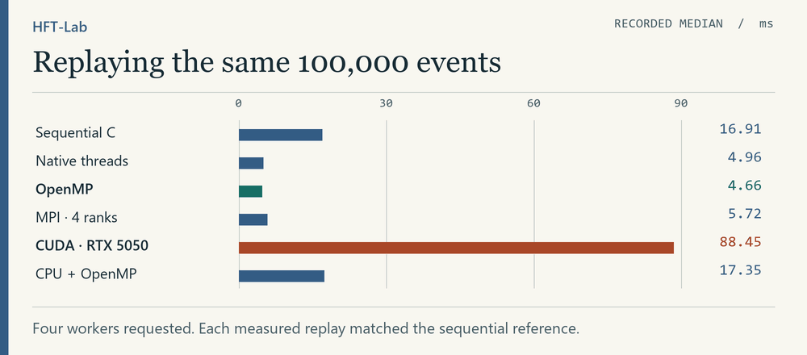

# HFT-Lab

How much faster can a limit order book run before its fills change? HFT-Lab replays a stream of synthetic orders through a C17 matching engine. The sequential run supplies the reference. A parallel run has to reproduce its results before its timing counts.

<picture>
  <source media="(prefers-reduced-motion: reduce)" srcset="docs/readme-media/workflow.png">
  
</picture>

The bars show the six measured median times from the complete comparison. [View the still figure](docs/readme-media/workflow.png)

## Six engines, one event stream

The recorded comparison used **100,000 correlated events across 16 instruments**, four requested workers, one warmup and three measured repeats. Each repeat passed the sequential correctness check. The times below are median native execution times on the recorded Windows laptop.

| Engine | Median time | Speedup vs. sequential |
| --- | ---: | ---: |
| Sequential C | 16.91 ms | 1.000× |
| Native threads | 4.96 ms | 3.408× |
| OpenMP | 4.66 ms | 3.630× |
| MPI, four local ranks | 5.72 ms | 2.956× |
| CUDA, RTX 5050 Laptop GPU | 88.45 ms | 0.191× |
| CPU + OpenMP | 17.35 ms | 0.974× |

OpenMP finished first on this workload. The CUDA kernels took about 10.5–10.6 ms, but allocation, transfers and matching raised the time for the whole native CUDA run. MPI used four processes on one host. [Benchmark and test record](docs/TEST_RESULTS.md)

## What runs in parallel

Orders at the same price have time priority. Cancellations and fills depend on earlier events, so each dependent instrument or instrument-pair partition keeps its order. The GPU computes eligible event features. The native engine handles the exchange state. Python generates the inputs, runs the experiments and exports reports.

The AI experiment adds a separate question. Logistic and MLP models learn from earlier synthetic events and replay on a held-out period. Their saved parameters can be evaluated in C. A simulated return describes that replay only. [Native implementation](native) · [Training code](ai_training)

## Run a local comparison

Start in the repository root with Python 3.11, CMake and a C/C++ build toolchain. On Windows, install Visual Studio C++ Build Tools before building. These commands create an isolated environment and build the locally available CPU engines.

~~~powershell
py -3.11 -m venv .venv
$python = ".\.venv\Scripts\python.exe"
& $python -m pip install -e ".[dev,science]"
& $python scripts/build.py --test
$hft = ".\.venv\Scripts\hftlab.exe"
& $hft generate --events 100000 --instruments 16 --seed 42 --output data/generated/market.csv
& $hft simulate --dataset data/generated/market.csv --engine sequential --strategy market-making
& $hft compare --dataset data/generated/market.csv --all --repeats 3 --output reports/engines.json
& $hft report reports/engines.json --output reports/engines.html
~~~

Open `reports/engines.html` to inspect your run. MPI and CUDA require their native runtimes and a build that enables them. To explore interactively, launch `.\.venv\Scripts\hftlab.exe` from the same terminal. [Build and presentation notes](docs) · [MIT license](LICENSE)
