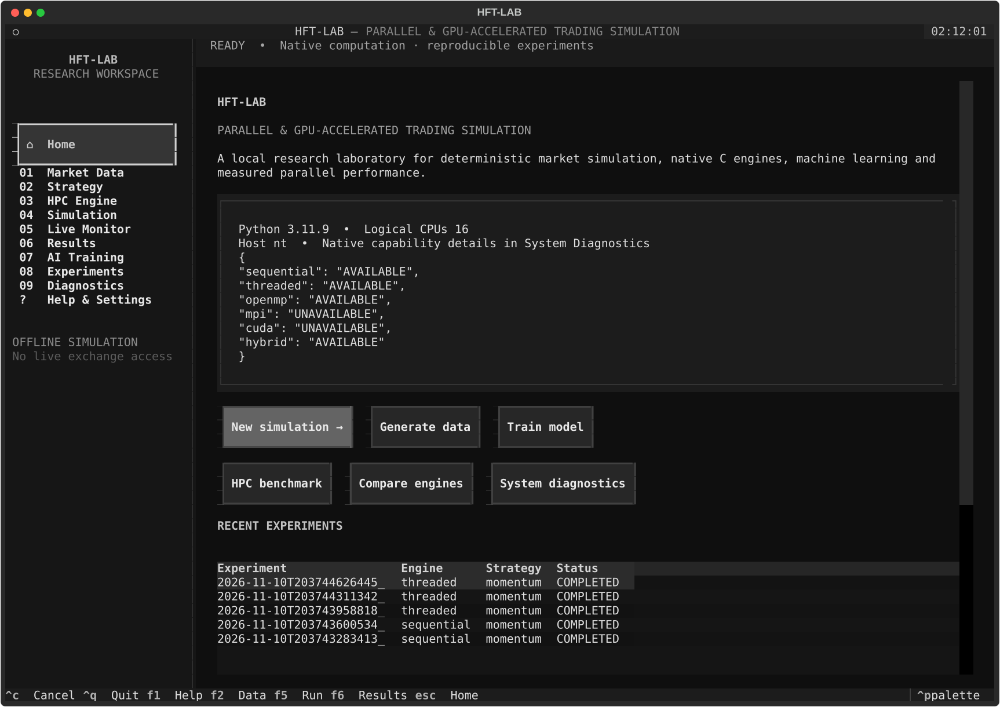

# Parallel and GPU-Accelerated High-Frequency Trading Simulation Engine

[](LICENSE)
[]()
[]()
[]()
[]()
[]()

> **Parallel & GPU-accelerated event-driven trading simulator featuring a deterministic C17 order book engine, OpenMP/CUDA scaling, embedded ML inference, and Python orchestration.**

---

### Highlights

* **⚡ Native C17 Engine:** Deterministic price-time priority limit order book, cancellations, and pre-trade risk checks verified against a sequential oracle.
* **🚀 HPC Acceleration:** Pinning modes, partition-parallel OpenMP, and hardware-separated MPI/CUDA execution.
* **🧠 Native AI Inference:** Chronologically purged ML models exported directly to native C softmax inference without Python runtime dependencies during matching.
* **📊 Modern TUI & Analytics:** Interactive Textual terminal dashboard, SQLite experiment database, and standalone HTML reports.

---

## Overview

An offline, event-driven trading simulator with a C17 exchange, Python experiment orchestration, native model inference, a Textual terminal application, and reproducible HPC comparisons. No exchange connections, brokerage credentials, or real orders are used.

The sequential engine is the correctness reference. Other engines preserve event ordering inside dependent instrument or instrument-pair partitions. Model classification metrics and synthetic P&L are research outputs, not evidence of financial profitability.

## Start on this Windows workspace

For presentation preparation, folder explanations, all local test commands, a live demo sequence, and locations for changing names, use the [presentation runbook](docs/PRESENTATION_RUNBOOK.md). Fresh verification results are recorded in [TEST_RESULTS.md](docs/TEST_RESULTS.md).

```powershell
.\.venv\Scripts\hftlab.exe
# Equivalent development entry point:
.\.venv\Scripts\python.exe -m hftlab
```

The virtual environment uses the installed **Python 3.11**, rather than the machine's default Python 3.15. Native code is built with the installed Visual Studio C toolchain.



## Install elsewhere

Linux/WSL2 is the primary portable HPC target; Windows supports native CPU threads and OpenMP.

```bash
python3 -m venv .venv
source .venv/bin/activate
python -m pip install -e '.[dev,science]'
python scripts/build.py --test
hftlab doctor
hftlab
```

Windows: `powershell -File scripts/install.ps1` (requires Python 3.11 and Visual Studio C++ Build Tools). `python scripts/build.py --mpi` enables an installed MPI implementation. `--cuda` requires a compatible installed CUDA toolkit/compiler/device; it is never enabled by a Python GPU package alone.

The installed CUDA 13.5 toolkit and Microsoft MPI runtime/SDK now support the
full local build. For this RTX 5050, use:

```powershell
.\.venv\Scripts\python.exe scripts/build.py --cuda --cuda-arch 120 --mpi --build-dir build/full --test
$env:HFTLAB_RUNNER = 'D:\HPC\build\full\hftlab_runner.exe'
.\.venv\Scripts\hftlab.exe doctor
```

## End-to-end demonstration

```bash
hftlab demo --events 10000 --epochs 15 --output artifacts/demo
```

This generates seeded educational market data, benchmarks requested engines with explicit unavailable statuses, trains logistic and MLP models, replays AI and classical baselines on a strictly held-out period, and exports JSON and offline HTML. See [the evaluation guide](docs/EVALUATION_DEMO.md) for held-out comparisons and scaling commands.

```bash
hftlab generate --events 100000 --instruments 16 --seed 42 --output data/generated/market.csv
hftlab simulate --dataset data/generated/market.csv --engine sequential --strategy market-making
hftlab simulate --dataset data/generated/market.csv --engine threaded --cpu-mode multi-multi --threads 4
hftlab compare --dataset data/generated/market.csv --all --repeats 3 --output reports/engines.json
hftlab train --dataset data/generated/market.csv --kind mlp --output models/reference
hftlab simulate --dataset data/generated/market.csv --strategy ai --model models/reference/model.hftmodel
hftlab report reports/engines.json --output reports/engines.html
hftlab experiments list
```

## Implemented components

- Native order book: price-time priority, partial and multiple fills, heap-based best quotes, indexed cancellations, and replacement.
- Portfolio accounting: cash, inventory, fees, slippage, realized/unrealized P&L, chronological equity curve, drawdown, and pre-submission risk checks.
- Strategies: market making, momentum, mean reversion, paired statistical arbitrage, trained AI, and HOLD reference.
- CPU modes: one worker pinned to one eligible logical CPU, multiple actual threads pinned to one logical CPU, one migratable worker, and multiple workers.
- Genuine OpenMP over independent partitions; CPU+OpenMP hybrid separates parallel features from serial exchange matching.
- Optional C MPI collective communication and CUDA `.cu` kernels, with local multi-process MPI and RTX 5050 AI replay verified against sequential.
- Streaming reproducible CSV and versioned binary market data, optional Parquet, eight synthetic scenarios, integrity manifests, and import validation.
- Chronologically purged logistic/MLP training, train-only scalers, safe numerical exports, native C softmax inference, and cross-language parity tests. Standard-library training works offline; sklearn/PyTorch are optional training backends.
- Nonblocking TUI, job cancellation/timeouts, SQLite experiment registry, JSONL events, engine comparisons, scaling experiments, and escaped offline reports.

## Architecture

```text
Textual TUI / argparse CLI
    → configuration + data/model validation
    → supervised subprocess / MPI launcher
    → C17 features + strategies + deterministic exchange
    → JSONL progress / versioned result JSON
    → SQLite experiment index + JSON/CSV/HTML reports
```

The performance-critical exchange and execution logic run in C. Python handles generation, training, presentation, persistence, and process supervision. `temp/` reference projects remain intact and independent; the new event-driven exchange does not replace their existing programs.

## Verification

```bash
python scripts/build.py --test
python -m pytest -q
python -m ruff check hftlab tests scripts
python -m build --no-isolation
```

[Implementation status](docs/IMPLEMENTATION_STATUS.md) and [test evidence](docs/TEST_RESULTS.md) distinguish tested, untested, partial, and unavailable functionality. The full Windows build now passes actual CUDA and multi-process MPI AI replay checks against sequential.

## Measurement and limits

Benchmark speedups compare the same native timed region across engines, including feature/inference processing and exchange matching. CSV loading, native setup, process startup, and Python validation are recorded separately. Repeats have correctness checks, median, standard deviation, and confidence intervals. Small datasets can be slower in parallel; results are never adjusted to imply a speedup.

Generation/import are streamed. Native simulation currently loads the event dataset and uses indexed work arrays in memory; exceptionally large datasets need an explicit memory budget. Strategies use fixed documented defaults, capital is partitioned by instrument, and synthetic QUOTE events provide modeled liquidity. This is an educational simulator, without calibrated market impact or claims of production readiness.

Further reading: [architecture](docs/ARCHITECTURE.md), [installation](docs/INSTALLATION.md), [user guide](docs/USER_GUIDE.md), [AI training](docs/AI_TRAINING.md), [data formats](docs/DATA_FORMAT.md), [HPC methodology](docs/HPC_METHODOLOGY.md), [troubleshooting](docs/TROUBLESHOOTING.md).
